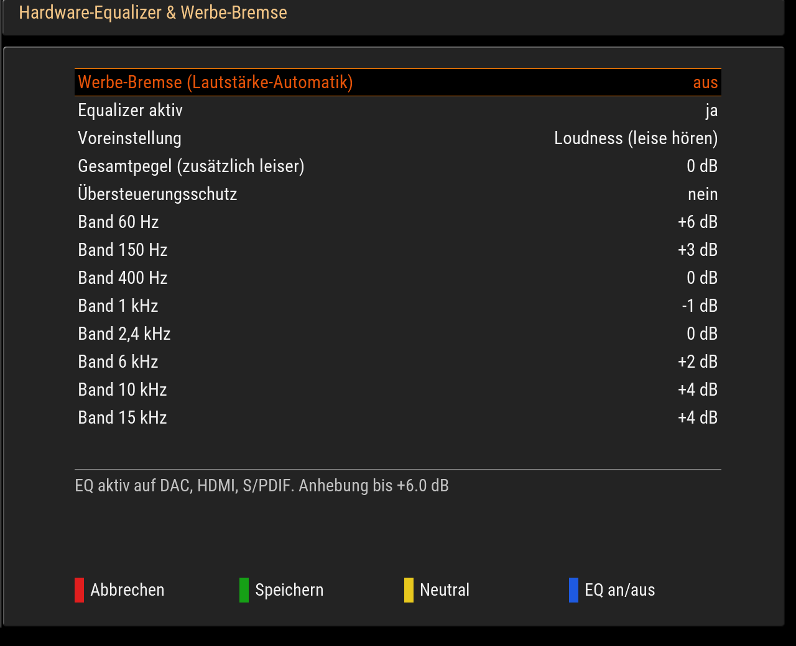
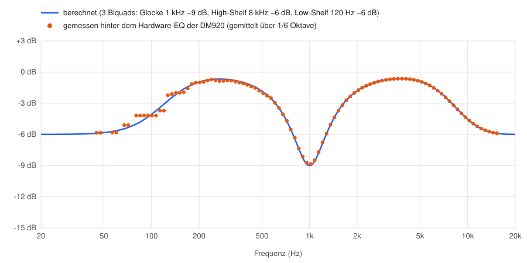

# DM920 Audio EQ

**Hardware-Equalizer und Werbe-Bremse für die Dreambox DM920** – ein Kernelmodul plus
Enigma2-Plugin, das den im Broadcom-Audiochip vorhandenen, aber nie freigeschalteten Equalizer
nutzbar macht und eine automatische Lautstärkeregelung gegen zu laute Werbung mitbringt.

Der EQ sitzt direkt im Audiopfad zwischen Decoder und den Ausgängen **HDMI, S/PDIF und DAC**.
Er rechnet in der Audio-Hardware des Chips – ohne CPU-Last, ohne Verzögerung, für Live-TV,
Aufnahmen und jeden Sender.

<p align="center"></p>

> *English summary:* Kernel module + Enigma2 plugin that enables the unused Broadcom BAPE hardware
> equalizer of the Dreambox DM920 (BCM7439) and inserts it between the audio decoder and the
> HDMI / S/PDIF outputs. 8-band parametric EQ with presets, plus an automatic level control
> ("ad brake") that measures loudness (ITU-R BS.1770) and attenuates when audio gets clearly louder
> than the programme. Verified by measuring the audio before and after the EQ inside the chip.

## Funktionen

- **8 Bänder** (60 Hz … 15 kHz, Shelf + Glockenfilter), je ±12 dB, Änderungen sofort hörbar
- **Wie ein echter EQ:** Bass anheben macht den Bass lauter, der Rest bleibt unverändert
- **Voreinstellungen:** Neutral, Mehr Bass, Sprache/Dialog, Loudness, Mehr Höhen, Nachtmodus
- **Übersteuerungsschutz** (optional): senkt beim Anheben automatisch so weit ab, dass die Gesamtverstärkung
  ≤ 0 dB bleibt. Ohne Schutz begrenzt die Hardware bei Vollaussteuerung sauber (kein Überlauf, gemessen)
- **Gesamtpegel** zum zusätzlichen Absenken
- **Werbe-Bremse** (Lautstärke-Automatik, *leicht / mittel / stark*): misst laufend die Lautheit und senkt
  ab, wenn es deutlich lauter wird als das laufende Programm – z. B. bei Werbung oder Trailern. Sie senkt nur
  ab, hebt nie an. Live-Anzeige der aktuellen Absenkung im Plugin
- Übersteht Senderwechsel und Wechsel des Tonformats (MPEG ↔ AC3 ↔ Dolby Digital 5.1 Downmix)
- Startet automatisch mit Enigma2, Einstellungen bleiben gespeichert

## Gemessen, nicht geschätzt

Der Treiber enthält eine Mitschnittfunktion (`BAPE_OutputCapture`). Damit wurde das Audiosignal
gleichzeitig **vor und hinter dem EQ im Chip** aufgezeichnet und der Frequenzgang berechnet:

<p align="center"></p>

Messung und Rechnung stimmen auf Zehntel-dB überein (Details: [docs/MEASUREMENTS.md](docs/MEASUREMENTS.md)).

## Voraussetzungen

| | |
|---|---|
| Receiver | Dreambox **DM920** |
| Image | OE 2.5 (getestet mit **New Nigma 2**) |
| Kernel | `3.14-1.17-dm920` |
| Audiotreiber | `bcm7439.ko` Version `20200321-dm920` |
| Zugang | SSH als `root` |

Das Modul bindet sich an interne Strukturen genau dieses Treiberstands. Es prüft beim Laden, ob alles
passt, und verweigert sich andernfalls, statt etwas kaputtzumachen. Andere Boxen (DM900 o. ä.) sind
ungetestet.

## Installation

**Mit fertigem Modul** (aus den [Releases](../../releases)):

```sh
git clone https://github.com/fkb83/dm920-audio-eq.git
cd dm920-audio-eq
mkdir -p dist && cp ~/Downloads/dm920eq.ko dist/
./install.sh <IP-der-Box>
```

**Oder selbst bauen** (braucht nur Docker, siehe [docs/BUILD.md](docs/BUILD.md)):

```sh
./build/build.sh
./install.sh <IP-der-Box>
```

`install.sh` kopiert das Plugin nach `/usr/lib/enigma2/python/Plugins/Extensions/HardwareEQ/`
und startet Enigma2 neu.

## Bedienung

**Blaue Taste → Erweiterungen → Hardware-Equalizer**

| Taste | Funktion |
|---|---|
| ◀ ▶ | Wert ändern (sofort hörbar) |
| Grün | Speichern |
| Rot / Exit | Verwerfen (zurück zum gespeicherten Stand) |
| Gelb | Alle Bänder auf Neutral |
| Blau | EQ an/aus |

Unten zeigt das Plugin, auf welchen Ausgängen der EQ wirkt, die stärkste Anhebung und – bei
eingeschalteter Werbe-Bremse – live, ob und wie stark gerade abgesenkt wird.

### Werbe-Bremse

| Stufe | setzt ein ab | Verhältnis | max. Absenkung |
|---|---|---|---|
| leicht | 4 dB über Programmpegel | 2:1 | −6 dB |
| mittel | 3 dB über Programmpegel | 3:1 | −10 dB |
| stark | 2 dB über Programmpegel | 5:1 | −15 dB |

Den Programmpegel lernt sie selbst: nach dem Umschalten in 3 s grob, in der ersten Minute zügig, danach
langsam (+0,6 dB/min nach oben, −1,2 dB/min nach unten), damit eine Werbepause nicht als „neuer
Normalpegel“ gelernt wird. Absenken dauert etwa eine halbe Sekunde, zurück geht es mit 1,5 dB/s.
Ein schneller Spitzen-Limiter ist das nicht – kurze Knalle gehen durch.

### Wichtig: Downmix einstellen

Der EQ bearbeitet **PCM-Ton**. Wird Ton als Bitstream (Passthrough) oder Mehrkanal-PCM ausgegeben,
läuft er am EQ vorbei. Für einen EQ auf allen Sendern in den Audio-Einstellungen der Box für
AC3, AAC, DD+ und DTS **„Downmix“** wählen. Das Plugin zeigt an, wenn der EQ auf keinem Ausgang aktiv ist.

## Wie es funktioniert

Kurzfassung – ausführlich in [docs/ARCHITECTURE.md](docs/ARCHITECTURE.md):

```
vorher:   Decoder ──stereo──▶ HDMI-Mixer ──▶ HDMI
nachher:  Decoder ──stereo──▶ Zwischen-Mixer ──▶ BAPE-Equalizer ──▶ HDMI-/S/PDIF-/DAC-Mixer
                               ▲ Lautstärke                           └─▶ Messabgriff
                               └──────────── Werbe-Bremse (Kernel-Thread) ◀──┘
```

1. Der Broadcom-Audiotreiber `bcm7439.ko` enthält die komplette *BAPE*-Audio-Engine inklusive
   Equalizer (Glocke, Shelf, Hoch-/Tiefpass, 8 frei programmierbare Biquads) – benutzt sie aber nie.
2. `dm920eq.ko` findet die internen Funktionen per `kallsyms_lookup_name` und den Audio-Kontext des
   Treibers über einen seiner `/proc/stb/audio`-Einträge.
3. Es hält den Decoder kurz an, baut die Kette um und trägt den EQ-Ausgang dort ein, wo der Treiber
   seinen Stereo-Ausgang verwaltet. Dadurch verdrahtet der Treiber bei jedem Formatwechsel selbst den EQ.
4. Das Plugin rechnet die Bänder (RBJ-Biquads) in Festkomma-Koeffizienten um und schreibt sie nach
   `/proc/dm920eq/biquads`. Die Hardware übernimmt sie im laufenden Betrieb.
5. Für die Werbe-Bremse hängt ein Abgriff (`BAPE_OutputCapture`) am DAC-Mixer des Treibers. Ein
   Kernel-Thread misst die Lautheit nach ITU-R BS.1770, rechnet die eigene Absenkung heraus und regelt
   die Eingangslautstärke des Zwischen-Mixers; die Mixer-Hardware blendet weich über.
6. Alle Treiberaufrufe laufen unter den Sperren des Treibers selbst. Nach Sendern mit DD+-Passthrough
   verknüpft der Thread die EQ-Kette neu, weil der Treiber sie sonst ins Leere laufen lässt.

Entladen (`rmmod dm920eq`) stellt den Originalzustand wieder her.

## Versionen

- **1.2.0** – Stabilität: Die Box konnte einfrieren, wenn der Audio-DSP neu startete, während die
  Werbe-Bremse maß (Absturz im Mess-Thread, Treibersperre blieb belegt). Der Messabgriff löste außerdem
  selbst DSP-Abstürze aus, wenn ein DD+-Sender (Passthrough) auf einen AC3-Sender folgte. Und nach jedem
  DD+-Sender wirkte der EQ bis zum Neustart nicht mehr. Alle drei Fehler sind behoben und auf der Box
  nachgestellt und gemessen (siehe [docs/MEASUREMENTS.md](docs/MEASUREMENTS.md)).
- **1.1.0** – echter EQ (Anheben = lauter), Werbe-Bremse.
- **1.0.0** – erste Version.

## Repository

| Pfad | Inhalt |
|---|---|
| [`kernel/`](kernel) | Kernelmodul `dm920eq.c` |
| [`plugin/HardwareEQ/`](plugin/HardwareEQ) | Enigma2-Plugin (Python 2.7) und Filterberechnung `eqmath.py` |
| [`build/`](build) | Docker-Build-Umgebung, Kernel-Vorbereitung mit Prüfsummen |
| [`tools/`](tools) | Koeffizienten-Rechner und Messauswertung |
| [`docs/`](docs) | Architektur, Build, Messungen |

## Haftungsausschluss

Dies ist ein inoffizielles Hobbyprojekt, nicht verbunden mit Dream Property GmbH oder Broadcom.
Es greift in einen geschlossenen Kernel-Treiber ein. Nutzung auf eigenes Risiko – im schlimmsten
Fall startet die Box neu; dauerhaft verändert wird nichts außer dem Plugin-Ordner.
Die Treiber-Interna wurden zur Herstellung von Interoperabilität analysiert; Teile des
Original-Treibers sind nicht enthalten.

## Lizenz

[GPL-2.0](LICENSE)
