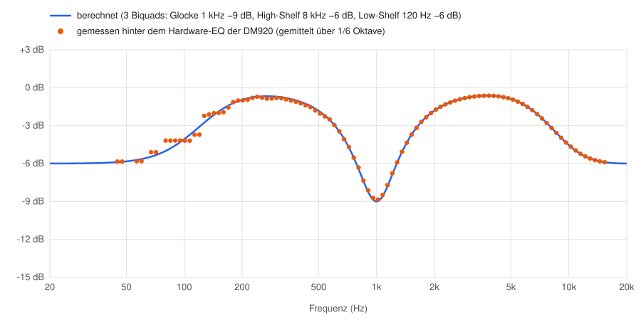

# Messungen

Ohne Messgerät am HDMI-Ausgang lässt sich trotzdem exakt prüfen, was der EQ tut: Der Treiber enthält
`BAPE_OutputCapture`, mit dem sich der Ausgang eines Mixers in einen Speicherpuffer mitschneiden lässt.

## Messaufbau

Mit `insmod dm920eq.ko taps=1` legt das Modul zwei zusätzliche Mixer mit Capture-Ausgang an:

```
Decoder ─┬─▶ Zwischen-Mixer ─▶ EQ ─┬─▶ HDMI / S/PDIF / DAC
         │                         └─▶ Tap 1 (hinter dem EQ)
         └─▶ Tap 0 (vor dem EQ)
```

`cat /proc/dm920eq/capture` leert beide Puffer, wartet 200 ms und liefert dann gleich lange Stücke
beider Abgriffe (32-Bit-Stereo, 48 kHz, interleaved). Die Messung nutzt das laufende Fernsehprogramm
als Testsignal.

Auswertung:

```sh
ssh root@<box> cat /proc/dm920eq/capture > cap.bin
python3 tools/capan.py cap.bin   # Pegelverhältnis (ohne numpy)
python3 tools/tf.py cap.bin      # Frequenzgang (braucht numpy, z. B. im Build-Container)
```

`tf.py` richtet beide Signale per Kreuzkorrelation aus und schätzt den Frequenzgang über das
Kreuzspektrum (Welch, Hann-Fenster).

## Ergebnisse

### Pegel (Custom-Stage, nur `b0`)

| eingestellt | gemessen |
|---|---|
| × 0,25 (−12,04 dB) | −12,01 dB |
| × 0,5 (−6,02 dB) | −6,12 dB |
| × 1,0 (0 dB) | −0,05 dB |

Umgestellt wurde jeweils live, ohne Tonunterbrechung.

### Vorzeichen-Konvention

Testfilter `b0 = 0,1, a1 = 0,9`: gemessen ein Tiefpass (−4,1 dB bei 1 kHz, −21,3 dB bei 10 kHz).
Für `y = b0·x + a1·y[n-1]` ergibt die Theorie −4,05 dB bzw. −21,3 dB. Die a-Koeffizienten werden also
addiert.

### Drei Biquads hintereinander

Glocke 1 kHz −9 dB (Q 1,4), High-Shelf 8 kHz −6 dB, Low-Shelf 120 Hz −6 dB:

| Frequenz | 50 Hz | 100 Hz | 200 Hz | 500 Hz | 1 kHz | 2 kHz | 5 kHz | 10 kHz | 15 kHz | 20 kHz |
|---|---|---|---|---|---|---|---|---|---|---|
| berechnet | −5,8 | −4,1 | −1,0 | −1,8 | −9,0 | −1,8 | −0,9 | −4,5 | −5,9 | −6,0 |
| gemessen | −5,0 | −3,9 | −1,0 | −1,9 | −8,7 | −1,8 | −0,9 | −4,5 | −5,9 | −6,0 |



Unter ~150 Hz streuen die Punkte etwas, weil ein 200-ms-Mitschnitt tiefe Frequenzen nur grob
auflöst.

### Über die Plugin-Oberfläche

Preset „Mehr Bass“ (+6/+4/+1 dB bei 60/150/400 Hz) per Fernbedienung gewählt (Version 1.0, damals mit automatischer
Vorverstärkung von −6,1 dB – heute der optionale Übersteuerungsschutz):

| Frequenz | 50 Hz | 200 Hz | 500 Hz | 1 kHz | 5 kHz |
|---|---|---|---|---|---|
| berechnet | −1,7 | −3,0 | −5,0 | −5,9 | −6,1 |
| gemessen | −1,5 | −3,1 | −4,9 | −5,9 | −6,1 |

### Formatwechsel

Mit aktivem Filter (Glocke 1 kHz −9 dB) zwischen Tonspuren gewechselt; der Treiber baut dabei seine
Kette neu auf (`streamtype set`):

| Tonspur | EQ an HDMI / S/PDIF / DAC | gemessen bei 1 kHz |
|---|---|---|
| AC3 (Ausgangszustand) | ja | −9,0 dB |
| MPEG Stereo | ja | −9,0 dB |
| Dolby Digital 5.1 (Downmix) | ja | −8,9 dB |

### Übersteuerung

Ausgänge stummgeschaltet, Breitband-Anhebung um +12 dB auf laufendes Programm (Spitzen bei 0,26 FS):

| | Ergebnis |
|---|---|
| Verstärkung unterhalb der Vollaussteuerung | +12,00 dB |
| Ausgang bei Übersteuerung | sauber auf 1,000 FS begrenzt |
| Samples mit Vorzeichensprung (Überlauf) | 0 von 46 übersteuerten |

Die Hardware sättigt also, statt überzulaufen – Anhebungen ohne Ausgleich können verzerren, aber nicht krachen.

### Werbe-Bremse

Lautheitsmessung im Kernel gegen eine Python-Implementierung von BS.1770 auf demselben Mitschnitt:
Abweichung um 1 dB (unterschiedliche Fensterlängen).

Regelverhalten mit künstlicher Schwelle (10 dB unter dem Bezugspegel, 5:1), damit sie auf normales
Programm reagieren muss:

| | erwartet | gemessen |
|---|---|---|
| Absenkung bei 6,9 dB Überschreitung | −5,5 dB | −5,4 dB (Anzeige), −4,6 dB (Signal, Pegel schwankte) |
| Freigabe | 1,5 dB/s | −5,6 → −4,1 → −2,6 → −1,0 → 0 dB im Sekundentakt |

Im normalen Programm (Stufe *mittel*, 60 s VOX HD) blieb die Absenkung bei 0 dB (einmal −0,1 dB).
Eine echte Werbepause wurde noch nicht mitgeschnitten.

### Stabilität (v1.2.0)

Anlass: Am 23.11.2026 hing die Box ab 06:27, während EPGRefresh im Standby Sender durchschaltete.
Nachgestellt im laufenden Betrieb, jeweils RTL UHD_ALT (DD+, Passthrough an HDMI) → SAT.1 HD (AC3),
gezählt wurden die Neustarts des Audio-DSP (`audio watchdog_isr`) in den 20 s danach:

| Variante | DSP-Neustarts | Box |
|---|---|---|
| ohne Modul | 0 | ok |
| v1.1.0 (Abgriff mit eigenem Mixer am Decoder) | 35–42 | Thread stürzte im Morgen-Fall ab → Box hing |
| v1.2.0-Vorstufe: alter Abgriff, aber mit Treibersperren | 35 | ok, Thread lief weiter |
| nur EQ, ohne Werbe-Bremse | 0 | ok |
| v1.2.0 (Abgriff am DAC-Mixer) | 0 (dreimal wiederholt) | ok |

Rundgang durch die Favoriten (Das Erste, ZDF, UHD1, RTL, 3sat, RTL UHD_ALT, arte, SAT.1, VOX; MPEG, AC3,
DD+ gemischt): 0 DSP-Neustarts, die EQ-Kette wurde genau nach den beiden DD+-Sendern neu verknüpft.

**EQ nach DD+:** Der EQ-Pegel wurde auf −12 dB gestellt und die Wirkung am Abgriff gemessen:

| Zustand | Wirkung |
|---|---|
| frisch geladen | −12 / −7 dB (Programm schwankt) |
| nach DD+ → AC3, v1.1.0 | ±0 dB – EQ wirkungslos |
| nach Neu-Verknüpfen | −13 dB |
| v1.2.0 automatisch nach DD+ | −8,5 / −10,3 dB |

**Werbe-Bremse misst unabhängig von Lautstärke und eigener Absenkung:**

- Box-Lautstärke 9 → 0 → 9: Lautheit −20,6 / −22,5 / −20,9 dB (Schwankung im Programm, kein Einbruch).
- Absenkung erzwungen (−8 … −10 dB): unkorrigierter Messwert fällt um 9–11 dB, die korrigierte Lautheit
  bleibt beim Bezugspegel (−18 … −20 dB bei Bezug −20 dB).

### HDMI-Eingang (v1.3.0)

Für diese Messungen hängt ein Abgriff direkt am HDMI-Ausgangs-Mixer (`maitap=1`, `/proc/dm920eq/level`).
Gemessen wird, wie stark der Pegel am HDMI-Ausgang fällt, wenn der EQ-Pegel von 0 auf −12 dB geht
(Mittel aus je zwei Messungen; das laufende Programm schwankt, Einzelwerte streuen um ±3 dB).

| Zustand | Wirkung am HDMI-Ausgang |
|---|---|
| v1.2.0, TV frisch | −13,1 dB |
| v1.2.0, nach HDMI-Eingang und zurück | **+0,6 dB – EQ wirkungslos** |
| v1.3.0, gemischte Folge (unten), an allen TV-Punkten | −11,7 … −13,4 dB |
| v1.3.0, nach Standby und Aufwachen | −10,0 dB |
| v1.3.0, nach Radio-Taste → HDMI-Eingang → Exit | −13,9 dB |

Gemischte Folge, nach jedem Schritt geprüft, ob alle PCM-Ausgänge am EQ hängen: VOX → HDMI-Eingang → TV →
RTL UHD (DD+) → SAT.1 → UHD1 (DD+) → HDMI-Eingang direkt aus DD+ → TV → arte (MPEG) → HDMI-Eingang → TV
→ ZDF. Ergebnis: jeder Zustand korrekt, 0 DSP-Watchdog-Neustarts, 0 Kernel-Fehler, 0 gescheiterte
Umbauten. Laden des Moduls bei laufendem HDMI-Eingang: Eingang wird sofort eingebunden.

**Ton des HDMI-Eingangs durch den EQ:** In einer Vorversion mit laufender Musik vom Apple TV: −11,8 dB
Wirkung bei −12 dB. Für v1.3.0 lieferte der Apple TV während der Tests nur digitale Stille; belegt ist hier,
dass der Datenstrom des HDMI-Eingangs durch die EQ-Kette zu allen Ausgängen fließt, nicht die Filterwirkung
mit Musik.

**Stille:** Das Festkomma-K-Filter der Lautheitsmessung hielt bei digitaler Stille einen konstanten
Grenzzyklus (gemessen −20 … −78 dB je nach Zustand beim Verstummen). Seit v1.3.0 wird es bei
vollständig stillen Blöcken zurückgesetzt; Stille misst −∞.

### Getrennte Profile (v1.4.0)

Testfilter am HDMI-Ausgang im TV-Betrieb (TV-Satz neutral, dann HDMI-Satz bzw. TV-Satz auf −12 dB):

| Änderung | Wirkung auf den TV-Ton |
|---|---|
| HDMI-Satz auf −12 dB | −0,6 dB (Schwankung des Programms) |
| TV-Satz auf −12 dB | −14,8 dB |

Nach Radio-Taste → Exit bleibt der TV-Satz geladen. Das Laden des HDMI-Satzes hängt an derselben
Erkennung „HDMI-Eingang spielt“ wie das Abschalten der Werbe-Bremse (v1.3.1 gemessen); mit Ton vom
HDMI-Eingang wurde es nicht gemessen, weil der Apple TV während des Tests schlief.

## Was nicht gemessen wurde

Der Abgriff hinter dem EQ ist derselbe Connector, an dem auch der HDMI-Mixer hängt. Das analoge
bzw. digitale Signal *an der HDMI-Buchse* selbst wurde nicht mit externem Gerät gemessen.
